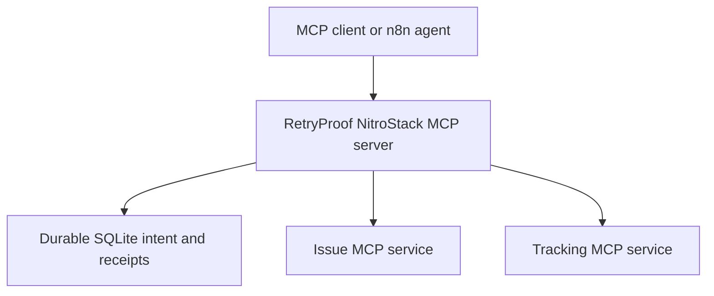

# RetryProof

**Recover an interrupted MCP workflow by checking what happened before taking another action.**

Developer Tools buildathon project by Harsh Popat. Original product/workflow: **n8n's recovery of a multi-service issue handoff**. This repository builds an external recovery layer; it does not modify n8n itself.

A GitHub issue can be created successfully even when its MCP response never reaches the caller. Blindly repeating the creation can produce a duplicate. RetryProof persists intent before dispatch, verifies the external record, and continues the handoff into a separate tracking service.

## Start here

Requires **Node.js 24+**, npm, and no API keys for the sandbox.

For the connected browser dashboard:

```bash
npm ci
npm run dashboard
```

Open **http://127.0.0.1:3400**, choose a setup option and Connect. The UI accepts GitHub, remote MCP and optional LLM credentials through the local backend. [Dashboard setup and replacement guide](docs/UI_SETUP.md).

For a judge-facing experiment run with independent record inventories and actual HTTP authentication evidence:

```bash
npm run experiments:local
```

This starts isolated local services, runs six keyless experiments, and labels four live GitHub/model experiments BLOCKED. It also saves separate SIGKILL recovery and controlled agent-rejection evidence. See the [experiment guide](docs/EXPERIMENTS.md) for live configuration, output files and claim limits. The [earlier participant run](experiments/README.md) is preserved with an explicit evidence review.

```bash
npm ci
npm run verify
npm run demo
```

`verify` builds the actual TypeScript project, runs unit/adapter/transport tests, and executes a baseline-versus-protected demo. It saves raw results in [`evidence/`](evidence/). Sandbox records are generated fixtures, not production incidents. Test and demo evidence contains real local MCP executions, without LLM inference or real GitHub account writes.

For a client such as NitroStudio, build then launch:

```bash
npm run build
npm start
```

`npm start` is an MCP STDIO process; it waits for JSON-RPC, so an otherwise quiet terminal is expected. Connect a client to `node /absolute/path/to/retryproof/dist/index.js`. See [`examples/mcp-client.json`](examples/mcp-client.json).

## What actually runs



Both downstream services are separate processes reached with the official MCP SDK. The issue service supports a deliberately non-idempotent sandbox or an optional GitHub REST adapter. The tracking service is an independent, persistent local release board, exposed over MCP. It is not a mock of Airtable, Linear, or another commercial product.

## The demonstration

| Experiment | What the program checks |
| --- | --- |
| Baseline | Withhold a real MCP response after a committed write; blindly retry; observe two records. |
| Protected recovery | Inject the same failure; recreate the gateway process; find the existing issue; create one linked tracking record. |
| Human edit | Change the external title before recovery; verify the edit survives. |
| Missing evidence | Hide the record from reads; repeat recovery five times; confirm no repeated write and no downstream progress. |

The test suite also kills the gateway with **SIGKILL between an external commit and the client timeout**, then recovers the still-`in_flight` operation from the saved intent.

## MCP tools

| Tool | Purpose |
| --- | --- |
| `rp_start_workflow` | Register a stable request, create/verify its issue, then create/verify the linked tracking record. |
| `rp_resume_workflow` | Reconcile uncertain effects and advance work that has never been dispatched. |
| `rp_get_receipt` | Read persisted state and chronological verification events. |
| `rp_discover_capabilities` | Obtain actual downstream MCP tool catalogs. |

Use one `request_id` for one logical task, including retries. A deliberately new task needs a new ID. Reusing an existing ID with different content is rejected. `paused` means **not completed**, even though the MCP call returned successfully.

## Precise guarantee

Within an intact, shared SQLite ledger, RetryProof claims **at most one gateway dispatch per persisted operation**. It verifies records before advancing the next step. An uncertain write is never automatically sent again.

This is **not universal exactly-once execution**. A crash after persisting the dispatch claim but before sending can leave work paused even when no effect happened. Missing records, unavailable services, truncated scans, or contradictory evidence never authorize a guessed retry. Restoring an older database or deleting state can invalidate deduplication history.

## Setup and review map

| Read | What it answers |
| --- | --- |
| [Judge brief](docs/JUDGE_BRIEF.md) | Problem, differentiator, judging criteria and evidence. |
| [Architecture](docs/ARCHITECTURE.md) | State machine, identities, transactions, concurrency and recovery. |
| [Setup](docs/SETUP.md) | Local run, GitHub mode, NitroStudio, HTTP and containers. |
| [Connected dashboard](docs/UI_SETUP.md) | Five setup modes, credential entry, browser actions and exact replacement files. |
| [n8n integration](docs/N8N.md) | Importable workflow and MCP Client Tool configuration. |
| [MCP API](docs/API.md) | Inputs, outputs and client behavior. |
| [Testing](docs/TESTING.md) | Reproduction commands and evidence limits. |
| [Experiment guide](docs/EXPERIMENTS.md) | Before/after inventories, actual HTTP 401 evidence, live opt-in and reconnect versus crash recovery. |
| [Measured results](docs/VALIDATION_RESULTS.md) | Final test counts, coverage, concurrency repetitions and clean-extraction outcome. |
| [Bug review](docs/BUG_REVIEW.md) | Bugs found, fixes, regression checks and remaining limits. |
| [Research](docs/RESEARCH.md) | Prior art and why the scope is narrow. |
| [Sources](docs/SOURCES.md) | Primary-source links and claim boundaries. |
| [Demo script](docs/DEMO_SCRIPT.md) | A short, reproducible judging walkthrough. |
| [Submission checklist](docs/SUBMISSION.md) | Remaining event deliverables. |

## Scope and verification boundary

The automated verification/demo and new keyless experiment evidence execute local MCP services; controlled HTTP/model fixtures are labeled as such. The separate participant-supplied historical receipts identify live GitHub issues and Groq agent responses, with the export limitations documented in [the historical review](experiments/README.md). Fresh live experiments require your explicit configuration and `npm run experiments:live`. Dashboard reconnect, graceful gateway recreation and SIGKILL recovery are separate checks. n8n UI operation, NitroStudio UI operation, Docker image construction and cloud deployment are not represented as completed.

A specific, supported workflow is the deliverable. Arbitrary MCP proxies, automatic rollback, payments, multi-tenant SaaS, and new MCP protocol extensions are outside this version.

## License

MIT. Framework/SDK dependencies retain their own licenses. Research and prior art are linked in [Sources](docs/SOURCES.md).
