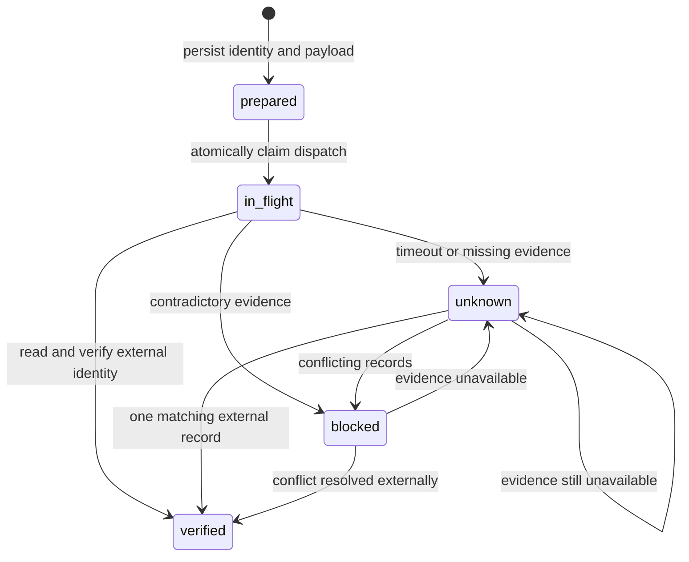

# Architecture and recovery invariants

## Scope

One workflow creates an issue and then a tracking record containing the verified issue identity and URL. The engine is deterministic. An LLM can choose the exposed MCP tools, but cannot override recovery rules with prose returned by a service.

The repository was scaffolded with the official NitroStack CLI (`typescript-starter`), then its sample calculator/widget content was replaced by the recovery implementation. NitroStack decorators and module bootstrapping expose the MCP interface [S06](SOURCES.md#s06). Downstream discovery and calls use the official TypeScript MCP client [S05](SOURCES.md#s05).

## State machine

There is deliberately **no edge from `unknown`, `blocked`, or `verified` back to `in_flight`**. A prepared operation can be sent because the gateway has not yet claimed a send. After a claim, uncertainty requires observation or operator investigation; it does not create permission to send again.

## Identity binding

1. The client supplies a stable logical `request_id` with a restricted character set.
2. The gateway binds it to title, body and both configured targets with a SHA-256 fingerprint.
3. Each step has a key `request_id:issue` or `request_id:tracking`.
4. A marker is `HMAC-SHA256(secret, [workspace, step key, step fingerprint])`.
5. Reusing a request with different content is an error, not silent deduplication.
6. A new ID means a new intentional task, even when its visible text is identical.

The signing secret must remain stable. Changing it is detected when an operation is reloaded. HMAC binds the marker to this gateway's intent; it does **not** prove provider honesty or prevent somebody with write access from copying an already visible marker. Multiple candidates therefore block adoption.

## Durable dispatch and races

`Store.prepare` persists the payload before any write. A read-only MCP connection/catalog preflight runs while the operation is still prepared. If that fails, a later call can safely retry initialization because no mutation has been dispatched. `Store.claim` then uses SQLite `BEGIN IMMEDIATE` and a state/version check to elect one dispatch owner. The claim is committed before the mutating MCP call starts. This prevents two processes sharing one ledger from both sending the same operation.

Every state change and its audit event commit together. SQLite WAL mode and `synchronous=FULL` are used [S11](SOURCES.md#s11). Lock timeout is configured at connection open and before journal-mode initialization, so startup contention is also handled. SQL parameters are bound; request values never become SQL source. Database files are private to the operating-system account.

Reads can race with an original write that is still returning. Recovery may observe its result and verify the operation first. A late response cannot overwrite that receipt: version checks return the newer state instead. The local active-operation set reduces redundant reconciliation within one process; the SQLite claim is the cross-process safety boundary.

## Crash windows

| Crash point | Persisted state | Recovery decision |
| --- | --- | --- |
| After run registration, before step preparation | Run exists; no step | Prepare the first step and execute it. |
| After preparation, before dispatch claim | `prepared` | A later caller can atomically claim it. |
| After claim, before actual network send | `in_flight` | Read external state; if inconclusive, pause. Availability is sacrificed here. |
| After external commit, before the response | `in_flight` | Find the exact marker and adopt the verified effect. |
| After timeout is saved | `unknown` | Perform reads; never resend that write. |
| After verification, before second step | First step `verified` | Prepare and execute the never-dispatched second step. |
| During the second step | Same rules for the tracker | Reuse the original verified issue. |

The ambiguous-completion problem is documented in an executable public MCP reproduction [S03](SOURCES.md#s03). It is a distributed-systems failure, not a newly invented MCP defect.

## Verification policy

The gateway requires a validated result envelope, exactly one candidate, matching marker, matching destination, matching cross-system source ID, and non-empty record ID/URL. A success-shaped create response is insufficient: a separate read must verify the result.

Title and body are intentionally not required to equal their initial values. A maintainer may edit them after creation. Recovery adopts the identity without writing the old text over those changes. A stored receipt proves an observation at its timestamp; completed replays return that historical receipt without promising the record still exists or remains unchanged.

The GitHub adapter reads repository issues with `state=all`, excludes PR records, verifies the creator ID against `/user`, and searches for the exact marker delimiter [S09](SOURCES.md#s09). It does not use GitHub's search index. A maximum ten pages bounds work; a full bound is `unavailable`, including when one candidate was seen but the unscanned remainder could hide another. This bounds latency; it does not guarantee complete discovery in a changing repository.

## MCP is the execution boundary

`RecoveryTools` is the public server surface. `ProviderClient` discovers and invokes separate MCP services. The engine reaches neither provider database directly. The issue and tracking providers own their domain state. The gateway owns operation identity and recovery policy.

MCP standardizes discovery and invocation [S01](SOURCES.md#s01). The ledger, reconciliation and deduplication policy are application logic, not properties automatically supplied by MCP. An API-based architecture could implement similar logic; this project makes it reusable at the supported MCP boundary across clients.

## What is not promised

No distributed transaction spans the two services. No automatic rollback occurs. Deleting the issue after verification does not automatically delete its tracker. No arbitrary upstream server or tool is accepted. Operators must keep one authoritative ledger and stable configuration; independently deployed replicas with separate databases are not coordinated.
